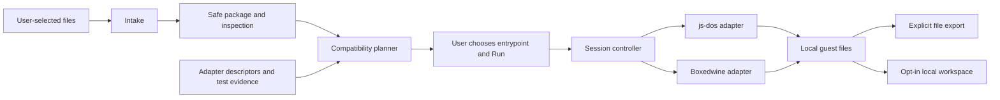

# PHANTOM OS architecture

Status on **2026-11-22: Prompt 10 compatibility validation; Windows remains disabled**.
The initial audit found an empty repository. The frontend now follows the module
boundaries below; bounded archive ingestion, deterministic planning and local profile
round-trips and the js-dos adapter are implemented. The separate Boxedwine boundary
has engine-only browser evidence, with adoption blockers preventing launch.
Manual opt-in OPFS storage and live DOS document transfer are implemented. Windows
application execution remains unavailable. See [workspace design](workspace.md),
[Prompt 9 evidence](evidence/prompt-9.md), [Prompt 8 evidence](evidence/prompt-8.md), [Prompt 7 evidence](evidence/prompt-7.md), [Prompt 6 evidence](evidence/prompt-6.md), [Prompt 5 evidence](evidence/prompt-5.md),
[product scope](product-spec.md) and
[capability evidence](compatibility-matrix.md).

Prompt 10 adds a production core suite for Chrome and Firefox, deterministic seeded
parser/ZIP invariants, a separate measurement harness and a pinned GitHub Actions
workflow. These use committed lawful fixtures only. Test artifacts keep failures,
environment details and runtime/profile hashes; they never enter the runtime's
automatic verified-compatible catalogue. See [the protocol](compatibility-testing.md)
and [the evidence](evidence/prompt-10.md). Performance instrumentation is outside
the shipped app; CI correctness does not stand in for laptop or human measurements.

## Guided UI and adapter events — Prompt 8

The six hash routes share one session controller. Inspect keeps candidate choice
above its next action, without auto-selecting an EXE. Compatibility exposes blockers
and a local metadata report; a separate Configure screen previews a validated
profile and requires an explicit continue action. Starting remains a separate
execution request. Advanced settings and runtime overrides use native details.

`src/app/demos.ts` accepts only two typed, fixed public fixture IDs. A bounded
response stream and exact SHA-256 checks precede normal File intake. No URL is
constructed from user metadata. Build-time copy reuses the prior licensed fixture
inventory and retains notices/source alongside the output. This does not alter
the final public-distribution license gate.

`RuntimeAdapter.prepare` has an optional typed progress callback (staging files,
verified engine asset count). `RuntimeSession.focusInput/releaseInput` stay behind
the DOS bridge, and input events report actual canvas focus. The parent first
focuses the browsing context, then requests canvas focus on the next frame to
avoid Chrome's asynchronous blur race. Start does not automatically capture input.
Fullscreen applies to the parent player panel, keeps its controls visible, and
never grants the guest same-origin access. Runtime timers feed a visible countdown.

Clipboard writing occurs only on the user's copy action. A denied/unavailable API
opens selectable text plus a local Blob download. Reports carry metadata and
uncertainty, never file contents or raw diagnostics; they have no remote endpoint.

## Deployment and package boundaries

Prompt 9 adds `src/security/`: shared production hosting headers and bounded
response consumption. The normal Vite preview and production acceptance enforce
the same policy; builds also embed a reduced meta-policy fallback. Development's
source transforms/HMR are separate. Root-hosted production uses exact static fetch
and frame paths, Blob-only workers, permission denial and no main-app eval.
See [security.md](security.md) for deployment conditions, threat model and limits.

Guest messages pass `runtime/dos/protocol.ts` before reaching the controller;
paths, aliases and resource counts are validated again on file export. Asset
streams cancel at 2 MiB before hashing. The opaque host denies additional device,
clipboard, storage and network APIs; its pinned loader still requires eval inside
that frame. A documented `asyncifyStats()` round trip detects silent worker death.
Refresh/history-cache entry synchronously aborts the frame on `pagehide`; timers
also check elapsed session time when scheduled. Browser suspension/hangs can delay
timers, and neither worker isolation nor byte budgets promise a total heap/CPU cap.

The frontend is **one npm application**, Vite + React + strict TypeScript. Keep the
following logical package boundaries inside `src/`; do not create a monorepo,
backend, plugin marketplace, or publishable packages before they are needed.
Dependencies point inward to domain contracts. The UI never calls emulator globals.

| Proposed boundary | Responsibility | Allowed dependencies / exclusions |
| --- | --- | --- |
| `src/domain/` | Serializable metadata, evidence, decisions, profiles and interfaces | No React, runtime imports, network, or storage side effects |
| `src/intake/` | Explicit File/Blob and folder selection; stable local handles | Domain, package normalization and browser file APIs; no host traversal or upload |
| `src/inspection/` | Bounded header parsing and structured diagnostics | Domain and local range reads; no runtime loading or execution |
| `src/packages/` | ZIP/folder normalization, safe paths, entrypoint candidates | Domain, inspection and one audited ZIP dependency; no autorun |
| `src/planner/` | Deterministic decisions from evidence, requirements and adapter descriptors; exact observed-evidence matching | Domain and validated profile schema; no runtime loader, network or storage |
| `src/profiles/` | Closed launch-profile schema, validation and local JSON import/export serialization | Domain and shared package path rules; no binaries, commands, runtime URLs or verification assertions |
| `src/runtime/` | Registry, session state machine, lazy adapter loading, budgets and teardown | Domain plus adapters through their contracts |
| `src/runtime/dos/` | Bridge the chosen js-dos/emulators build into PHANTOM contracts | Pinned upstream API; all DOS config, mount and I/O translation stays here |
| `src/runtime/boxedwine/` | Disabled adapter, explicit adoption blockers, validated D: argv/mount plan and engine-only Emscripten bridge | Real 25R1 bootstrap trial; no Wine filesystem or Windows session installed; no assumed API equivalence to js-dos |
| `src/workspace/` | Temporary files, opt-in OPFS packages, profiles, export and deletion | Domain and browser storage; no cloud persistence |
| `src/security/` | Static hosting policy and bounded asset response streams | No selected metadata, runtime globals or persistence; shared by build/preview acceptance |
| `src/app/` | Home/Inspect/Compatibility/Configure/Player/Workspace, accessibility and user choices | Public boundaries above; no parser duplication or fake framebuffer |
| `tests/` and later `public/runtimes/<id>/<build>/` | Lawful test corpus/evidence and pinned self-hosted runtime assets | Kept separate from imported user files; add only at the owning prompt |

Runtime JS/WASM/workers and audited base filesystems are public static downloads
from fixed, versioned paths. They never include user-specific parameters. All
selected-file bytes stay in File/Blob, browser memory, the guest VFS, or explicitly
enabled origin-local storage. No application server receives them.

## Implemented contracts and current adapters

The authoritative strict types now live in
[`src/domain/contracts.ts`](../src/domain/contracts.ts). They define
`FileArtifact`/`LocalFile`, `ApplicationPackage`, `ProbeResult`, per-field `ProbeEvidence`,
`ProbeDiagnostic`, `PackageInspector`,
`CompatibilityPlanner`, `RuntimeDescriptor`, `RuntimeAdapter`, `RuntimeSession`,
`PreparedSession`, `LaunchProfile`, `SessionRecord`, `ExportArtifact` and
`LocalWorkspace`. These are PHANTOM interfaces, not invented vendor API methods.

- `PackageInspector.inspect(package, signal)` returns per-file `ProbeResult` objects.
  `selectionInspector` dispatches to bounded executable/container probes behind a
  shared range reader. MZ/PE/NE/ELF, ZIP and selected disk signatures expose actual
  field bytes and diagnostic warnings. No runtime or network API is involved.
  See [analyzer.md](analyzer.md) for validation scope, evidence and uncertainty rules.
- `src/packages/` normalizes file/folder/ZIP inputs into one schema-versioned virtual
  package: preserved files/directories, origin, candidate/resource hints and optional
  explicit entrypoint. ZIP preflight and bounded Deflate/CRC processing run in one
  terminable worker whose production code is bundled inline with the app, permitting
  offline imports after Inspect loads. Adapters consume the same file handles; they must not re-extract
  ZIPs or discard companions. [Package import](package-import.md) specifies the
  accepted subset, path checks, quotas, worker lifecycle and limitations.
- `CompatibilityPlanner.plan(package, inspection, descriptors, request)` now returns
  one of six deterministic decisions, separate `canLaunch`/engine availability,
  automatic suggestion versus override, structured actionable issues, declared
  missing files and human-readable reasons. See [planning/profile rules](compatibility-planning.md).
  DOS COM/MZ and Windows NE/x86 PE32 have explicit rules. The production disk
  environment allow-list is empty. No executable result follows from confidence.
- `RuntimeAdapter` exposes a descriptor, static `probe`, `prepare` and `launch`.
  `RuntimeSession` owns events, file import/export, idempotent stop and final disposal.
  The DOS adapter implements preparation, launch, events, live guest export and
  teardown, plus bounded live imports through fsWriteFile. See [DOS runtime details](dos-runtime.md).
- `LocalWorkspace` defines manifest/save/restore/backup/remove/estimate operations.
  `OpfsWorkspace` implements one explicitly saved origin-local workspace with a
  closed portable manifest, chunk hashes, atomic generation head and cross-tab Web
  Locks. Temporary selections/guest snapshots remain React-owned; nothing writes
  until manual opt-in plus Save. See [storage protocol and limits](workspace.md).
- The registry holds lightweight descriptors and optional on-demand loaders. It
  invokes a loader only for an available, pinned build, caches successful imports,
  rejects duplicate IDs, incomplete installation claims and complete descriptor
  mismatches (including assets/capabilities), freezes its metadata and allows retry
  after failure. DOS now has a pinned installed descriptor and lazy loader; the
  Windows descriptor remains unavailable. App-owned adoption blockers also prevent
  installation, even if an available flag or imported profile is changed. Blockers
  are frozen in the registry and exposed by the planner; no profile can waive them.
  Heavy engine code is not imported by
  inspection/planning or by visiting Player before Start.
- `session-machine.ts` implements idle → selected → inspecting → ready/unsupported
  → preparing → running → stopped/error. Only the adapter's first actual framebuffer
  permits STARTED. Runtime failures retain the package/profile for recovery; request
  IDs and the session job guard reject stale completions. Stop aborts preparation
  or awaits real worker exit, with bounded forced removal. Navigating away from
  Player stops the guest. No synthetic launch event is dispatched for test data.

The DOS sandbox is a separate content-hashed HTML document, without same-origin
permission. The parent passes verified engine buffers and selected package bytes
through a MessageChannel; the opaque frame starts a real DOSBox WebAssembly worker.
Its CSP denies all connections; fixed in-memory JS/WASM facades, disabled storage,
network APIs and raw logging prevent upstream services from being used. The parent
has no eval permission in production. A worker memory ceiling and bounded VFS
writes supplement the package/profile limits; these are not a perfect hostile-code
security boundary. The [runtime guide](dos-runtime.md) records exact limits, API,
CSP deployment requirements, source hashes, failure handling and tested behavior.

Screens are independently lazy-loaded with React Suspense. Hash routing supports
static hosting; no routing framework or runtime dependency is added unnecessarily.
The error boundary and logger use fixed diagnostic codes, never arbitrary error
messages, filenames, contents or stack traces.

Contract invariants:

- Recognition and launch planning are different data. `valid-header` does not mean
  valid program, trusted package, or available OS/library dependencies.
- The observed-launch catalogue is app-owned and currently empty. A future test
  coordinator can compute a bounded, full-content SHA-256 chunk-manifest identity,
  including paths/directories, canonical profile, runtime descriptor/asset hashes
  and exact browser scope. A process-local opaque identity plus reviewed passing
  observations must match; changing any companion or configuration invalidates it.
  Header-only inspection never fingerprints a whole package or grants verification.
  Imported JSON, IDs, filenames and confidence cannot create that identity or add
  records. Matching mechanics are unit-tested only, using explicitly test-only data.
- Static descriptors load without their WASM engines. `canLaunch` is false for
  unavailable adapters, invalid packages, unresolved entrypoints and hard unmet
  requirements. Candidate attempts require explicit Run; no automatic guest start.
- Profile JSON has no binaries, host paths, executable JavaScript, arbitrary runtime
  URLs, args or raw shell commands. Its closed version-1 schema validates paths,
  controls, mounts, file references and limits. Unresolved drafts have explicit null
  runtime/version/build fields; they are exportable but cannot grant launch eligibility.
  Future adapters must encode accepted filenames safely and reject unsupported syntax
  rather than injecting paths into DOS AUTOEXEC/Wine launch commands.
- `prepare` may fetch pinned public assets and stage local files but must not execute
  the selected program. A combined upstream startup API can do that work in `launch`.
- Import/export methods reject with a typed unsupported-operation error if the
  descriptor does not advertise that capability. The UI obeys the timing mode.
  A promised `after-stop` export must remain usable after `stop`, before `dispose`.
- Preparation failure/cancellation releases temporary resources. A stopped/crashed
  session cannot retain input listeners, pointer lock or playing audio. Force-stop
  must terminate workers/frames when graceful shutdown exceeds the budget; report
  potential unsaved-data loss and require a fresh session on relaunch.
- Storage failures are recoverable. Persisting a profile does not implicitly save its
  software. Request original files again when a restored profile has no package.

## Runtime reuse and investigation boundaries

**DOS:** Prefer js-dos's maintained `emulators` embedding API, with a worker backend
if the selected build supports the required output and file operations. Upstream
documents local filesystem inputs and worker factories; this makes it a candidate,
not a tested PHANTOM integration. Bind framebuffer, input and file operations to
the actual versioned API. Disable optional network/cloud/remote-drive/debug paths.
Never pass user packages through a URL upload service. See the
[upstream embedding API](https://js-dos.com/emulators.html).

**Windows:** Boxedwine's documented approach combines CPU/Linux environment
emulation with 32-bit Wine; upstream lists 16/32-bit Windows and Web targets.
Reuse its Emscripten build and a separately audited Wine filesystem. This is a
distinct adapter, not a DOS badge applied to PE files. Start with one x86 PE32
Wine Notepad fixture. NE/Win16 needs separate evidence. Prompt 6 exercises the
25R1 engine's memory filesystem and expected missing-Wine failure in an opaque
browser frame. No Windows program, framebuffer/input, live-process termination or
guest export is verified. The reviewed Wine 6.0 root lacks a retained component
source/license inventory; its PE Notepad is a Wine placeholder. Keep this adapter
disabled. [The trial guide](boxedwine-runtime.md) records exact pins, documented
APIs, the audit, reproducer and the smallest follow-up needed to enable a trial.

**Deferred:** v86 is a possible full-machine path, not a general ELF loader or an
MVP dependency. Classic Mac requires a separate emulator/ROM/OS feasibility study.
Do not add either until the optional stage is requested.

## Local isolation and processing budgets

Run parsers/extraction and emulation off the UI thread where the chosen libraries
permit. Give runtime contexts only the selected virtual package and narrow session
messages. Keep runtime code and state behind the adapter; prefer a dedicated worker
or constrained frame. Same-origin workers still have origin privileges: review
their network/storage behavior and do not market this as a secure malware sandbox.

Self-host audited assets, allow only their fixed fetch paths, disable guest network
bridges and dynamic URLs, and omit telemetry. Choose CSP from the actual runtime
needs; do not enable broad script evaluation by default. If threads require
SharedArrayBuffer/cross-origin isolation, document and test the needed COOP/COEP
headers and browser support. Provide a measured single-thread fallback only when
it exists; otherwise show an unavailable-runtime reason. No privileged host mounts.

Processing budgets (Windows remains disabled):

| Resource | Limit / behavior |
| --- | --- |
| Selected files | 64 MiB per file, 128 MiB total package, 2,048 entries including virtual directories; reject before materializing excess data |
| Static probe — implemented | At most 1 MiB actual reads per file, 64 KiB per slice and 32 reads; validate offsets/lengths before reading, reuse covered ranges and report partial when policy limits prevent inspection; at most 64 evidence fields / 16 displayed bytes per field; 8 MiB cumulative package reads |
| ZIP extraction — implemented | 128 MiB actual total output, 64 MiB per entry, 100:1 expansion ratio ceiling, 2,048 entries; check declared sizes first and enforce actual streamed output limits |
| Nested/ambiguous inputs | Nested archives retained as opaque files, never recursively expanded; encryption, ZIP64 and unsupported methods get explicit errors |
| Paths | Reject traversal, absolute/drive/UNC paths, NUL, symlinks and normalized/case-fold collisions; preserve safe relative paths; never write directly to a host path |
| Processing lifecycle — implemented | Header probes use async Blob reads, bounded main-thread loops and AbortSignal. ZIP has its own dedicated worker. 30-second controller and extraction deadlines; cancel/error/success terminate the ZIP worker. Request IDs reject stale results |
| Runtime | One active session; DOS guest memory ceiling 64 MiB; graceful-stop budget 2 seconds; profile session limit up to 30 minutes; UI instructs capture/export before stopping. Player shows remaining minutes and highlights the last minute before the unchanged timed stop |
| Windows runtime | Memory/startup limits must be established by the Boxedwine trial before enabling it; do not reuse the DOS ceiling or promise a browser heap cap |
| Persistence — implemented | Opt-in OPFS; 128 MiB saved bytes, 64 MiB/file, 32 MiB captured files, 2 MiB manifest, ≤1 MiB reads; prior generation preserved until atomic commit. Quota/denial/eviction errors retain temporary processing and exports |

User input must not reach fetch URLs, beacons, sockets, off-device logs, or exception
reporters. Browser acceptance must inspect page and worker traffic, use sentinel
filenames/content, reject unexpected requests, and repeat with the network blocked
after assets are cached. Runtime asset caches may persist; selected software may
not persist without opt-in. Service workers must not cache user data implicitly.

## Dependency and license gate

**The classic DOSBox/emulators 8.5.3 path is adopted for private local development.**
The [runtime adoption audit](runtime-license-audit.md) records exact assets, sources,
licenses and acceptance. Prompt 11 records a compatible GPL-2.0-only project license; public runtime
distribution still requires the [source rebuild review](source-rebuild.md). Boxedwine 25R1 was investigated with an engine-only
browser probe, but is not adopted or distributed; see its [separate audit](boxedwine-runtime.md#why-the-adoption-gate-stays-closed).
Other emulator rows remain research candidates.
Frontend dependencies are pinned and reviewed in [the dependency inventory](dependency-licenses.md).
Prefer the smallest auditable distributions, then choose exact versions after the
gate below. Public browser assets are distributed software and need their own
compliance record. “Open source emulator” is not a license for its guest files.

| Candidate | Primary evidence inspected | Adoption condition |
| --- | --- | --- |
| js-dos wrapper and `emulators` core | [js-dos package metadata](https://github.com/caiiiycuk/js-dos/blob/8.xx/package.json) and [emulators metadata](https://github.com/caiiiycuk/emulators/blob/8.xx/package.json) declare `GPL-2.0` | Resolve exact grants from chosen source headers/license files; audit DOSBox/DOSBox-X and bundled JS/WASM/worker dependencies separately; retain notices and matching source/build materials |
| Boxedwine | [GPL v2 text](https://github.com/danoon2/Boxedwine/blob/master/license.txt) and upstream README | Inventory engine, Emscripten outputs, SDL/other linked libraries and patches; provide the corresponding source required for the distributed build |
| Wine and its root filesystem | [Wine Notepad source header](https://github.com/wine-mirror/wine/blob/master/programs/notepad/main.c) grants LGPL-2.1-or-later for that source | Audit the entire selected Wine build, root filesystem, dependencies and fonts component by component; preserve LGPL notices/source and applicable modification/relinking rights; exclude uncertain proprietary DLLs |
| FreeDOS fixtures | [FreeCOM package metadata](https://github.com/FDOS/freecom/blob/master/command.lsm) and [GPL v2 license](https://github.com/FDOS/freecom/blob/master/license); [MEM metadata](https://github.com/FDOS/mem/blob/master/doc/mem.lsm) declares GPL | Choose an official build/source pair, record hashes and per-file terms, and ship required notices/source; neither package licenses other DOS software |
| React, Vite, TypeScript and test tooling | Installed pinned versions and licenses are recorded in [the inventory](dependency-licenses.md), with full browser notices | Re-audit on changes; fflate 0.8.3 streaming Inflate is now pinned/audited for ZIP import; minimize dependencies |
| Optional v86 | [BSD-2-Clause license text](https://github.com/copy/v86/blob/master/LICENSE) | Deferred; audit bundled dependencies, BIOS/VGA firmware and every guest image separately; engine licensing grants no rights to arbitrary OS images |

Before adopting a runtime build:

1. Record upstream URL, immutable commit/release, download origin, SHA-256 hashes,
   build flags/toolchain, and each distributed file's role.
2. Create an inventory of SPDX expressions (or unresolved terms), license files,
   copyright notices, bundled dependencies, fixtures, and guest assets. Read actual
   grants; do not silently reinterpret ambiguous `GPL-2.0` metadata as “or later.”
3. Check the intended PHANTOM distribution license against all shipped components.
   A GPL-compatible open-source distribution is the proposed direction; no final
   project license is asserted in Prompt 0. Do not assume lazy loading, a worker,
   or an iframe settles whether code forms a combined work. Resolve uncertainty
   before redistribution; keep the affected adapter disabled meanwhile.
4. Plan matching source archives, patches, build/install scripts, license texts,
   attribution and any applicable LGPL replacement/relinking materials alongside
   release assets. A link to a moving upstream branch is not that source bundle.
5. Verify that the chosen build can obey local-only networking/storage rules and
   run the lawful fixture in the actual PHANTOM browser integration.
6. Record the decision and evidence before enabling the adapter. At adoption, add
   `THIRD_PARTY_NOTICES.md` and an asset/license inventory with real entries; do
   not create empty compliance placeholders now.

Build selection, license clearance, successful download and successful execution
are separate gates. Frontend verification does not pass the emulator gates.
